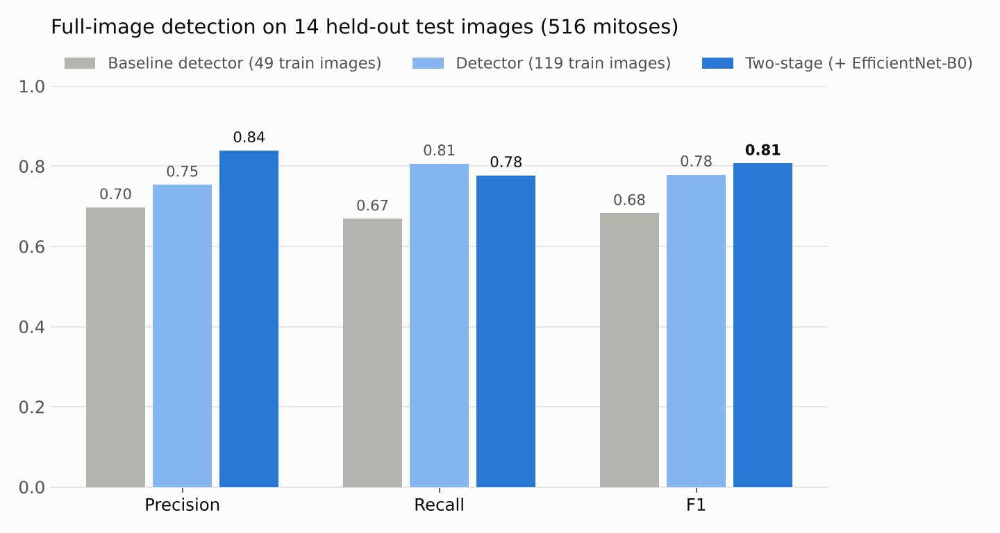
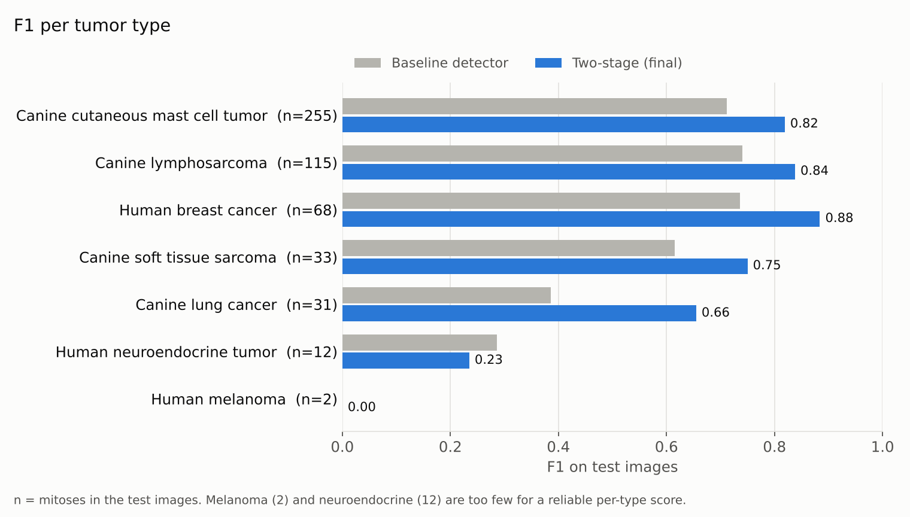
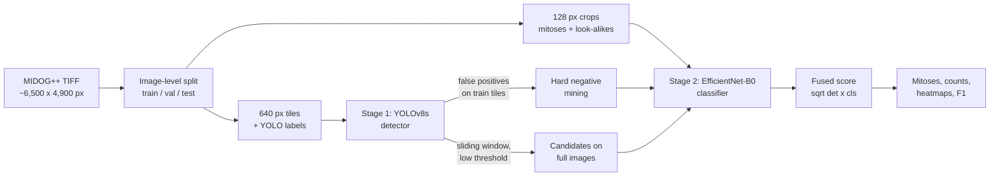

# Mitotic Figure Detection in Histopathology Images

A two-stage deep learning pipeline that **detects, classifies and counts mitotic figures** (dividing cells) in high-resolution H&E histopathology images across **7 human and canine tumor types**, trained and evaluated on the expert-annotated [MIDOG++](https://doi.org/10.1038/s41597-023-02327-4) dataset.

Mitotic count is one of the key measures pathologists use to grade tumors. Counting by hand is slow, and results vary between observers. This project automates it end to end:

- **Stage 1:** a YOLOv8 detector scans each ~6,500 x 4,900 px image with sliding-window inference and proposes candidate mitoses.
- **Stage 2:** an EfficientNet-B0 classifier inspects a crop around every candidate and rejects look-alike cells.

| | Precision | Recall | **F1** | Count correlation (r) |
|---|---|---|---|---|
| **Final two-stage model** (held-out test images) | 0.839 | 0.777 | **0.807** | **0.994** |



---

## Contents
- [Results](#results)
- [How it works](#how-it-works)
- [Repository structure](#repository-structure)
- [Quick start](#quick-start)
- [Step-by-step pipeline](#step-by-step-pipeline)
- [Design decisions](#design-decisions)
- [Dataset](#dataset)
- [Limitations and next steps](#limitations-and-next-steps)
- [References](#references)

---

## Results

All rows use the **same 14 held-out test images (516 mitoses)**. A detection counts as correct if its center is within 30 px (about 7.5 um) of an expert-annotated mitosis, which is the MIDOG challenge criterion. The confidence threshold and the score-fusion variant were chosen on the 7 validation images only. The test set was never used for tuning.

| Model | Train images | Precision | Recall | **F1** | Count correlation | Mean abs. count error / image |
|---|---|---|---|---|---|---|
| Baseline: YOLOv8s detector | 49 | 0.697 | 0.669 | 0.682 | 0.975 | 7.9 |
| + more training data, fixed LR schedule | 119 | 0.754 | 0.806 | 0.779 | 0.994 | 5.9 |
| **+ EfficientNet-B0 verifier (two-stage)** | 119 | **0.839** | 0.777 | **0.807** | **0.994** | **5.7** |

**What each step contributed**
- **More data (+0.097 F1):** expanding from 49 to 119 training images (2,654 to 6,389 tiles) gave the largest gain, mostly in recall. This run also fixed a schedule issue: the first run's time-capped training had stretched the learning-rate schedule (see [Design decisions](#design-decisions)).
- **Second-stage classifier (+0.028 F1):** precision rose from 0.754 to 0.839 while recall dropped by only 0.03. This matches the classifier's purpose, which is to reject look-alike cells. It reached a validation ROC AUC of 0.935 on detector candidates.

**Score fusion** (each variant's threshold tuned on val, then applied to test):

| Variant | Val F1 | Test precision | Test recall | Test F1 |
|---|---|---|---|---|
| Detector only | 0.855 | 0.754 | 0.806 | 0.779 |
| Classifier only | 0.817 | 0.855 | 0.653 | 0.741 |
| **Geometric mean** (chosen on val) | **0.867** | 0.839 | 0.777 | **0.807** |
| Average | 0.865 | 0.839 | 0.769 | 0.803 |

**Per tumor type**



| Tumor type | Test mitoses | Precision | Recall | F1 |
|---|---|---|---|---|
| Human breast cancer | 68 | 0.823 | 0.956 | 0.884 |
| Canine lymphosarcoma | 115 | 0.926 | 0.765 | 0.838 |
| Canine cutaneous mast cell tumor | 255 | 0.831 | 0.808 | 0.819 |
| Canine soft tissue sarcoma | 33 | 0.913 | 0.636 | 0.750 |
| Canine lung cancer | 31 | 0.704 | 0.613 | 0.655 |
| Human neuroendocrine tumor | 12 | 0.400 | 0.167 | 0.235 |
| Human melanoma | 2 | 0.000 | 0.000 | 0.000 |

The melanoma and neuroendocrine test images contain only 2 and 12 mitoses, so their per-type scores are not statistically meaningful. Missing 2 cells gives an F1 of exactly 0. The overall F1 across 516 mitoses is the reliable number.

**Context.** Published systems trained on the full dataset report F1 around 0.76 to 0.82. Examples: the MIDOG 2022 winner scored 0.764 on the challenge test set, and a YOLOv12 model reached 0.817 in MIDOG++ cross-validation. Those results use different test splits, so they aren't directly comparable. This project used about 24% of MIDOG++ for training.

Other numbers: the detector's tile-level test mAP50 is 0.853, and tiled inference runs at about 16 megapixels/s on a single NVIDIA T4 (about 2 s per full image). All metrics are in [`results/metrics_summary.json`](results/metrics_summary.json).

---

## How it works



1. **Tiling:** each large image is cut into overlapping 640 x 640 tiles (64 px overlap). Background (white glass) is skipped. Every tile containing a mitosis or a look-alike "imposter" cell is kept, plus 15% of the remaining tissue tiles.
2. **Detector:** a COCO-pretrained YOLOv8s is fine-tuned on the tiles with on-the-fly histopathology augmentation.
3. **Sliding-window inference:** on a full image, tiles are processed in batches, boxes are shifted back to image coordinates, and duplicates from overlapping tiles are merged with center-distance NMS.
4. **Hard negative mining:** the trained detector runs over the training tiles, and its false positives become extra negatives for the classifier.
5. **Classifier:** EfficientNet-B0 (ImageNet-pretrained) learns *mitosis vs look-alike* from 8,502 crops: 3,125 mitoses, 3,678 imposters and 1,699 mined false positives.
6. **Fusion:** each candidate's final score is the geometric mean of the detector confidence and the classifier probability (8-fold flip/rotation test-time augmentation). The final threshold is applied to that score.

---

## Repository structure

```
.
├── configs/default.yaml           all hyperparameters (the settings used for the reported results)
├── src/mitosis/                   the library
│   ├── data/
│   │   ├── annotations.py         MIDOG++ JSON parsing ([x1,y1,x2,y2] boxes, mitosis vs imposter)
│   │   ├── split.py               balanced image-level split, extendable without changing val/test
│   │   ├── download.py            figshare download with retries
│   │   ├── io.py                  TIFF reading, centred crops with padding
│   │   ├── tiling.py              overlapping tiles + YOLO labels
│   │   ├── crops.py               classifier crops
│   │   └── builder.py             streaming builder: download -> tile -> crop -> delete
│   ├── detection/
│   │   ├── train.py               YOLOv8 fine-tuning with a schedule-preserving time cap
│   │   ├── inference.py           sliding-window inference + cross-tile NMS
│   │   └── candidates.py          stage-1 candidates on full images (cached)
│   ├── classification/
│   │   ├── dataset.py             crop dataset with rotation/flip/stain augmentation
│   │   ├── model.py               EfficientNet-B0, test-time augmentation
│   │   ├── mining.py              hard negative mining
│   │   └── train.py               class-balanced training, model selection by val AUC
│   ├── evaluation/
│   │   ├── matching.py            MIDOG center-distance matching, precision/recall/F1
│   │   ├── metrics.py             per-tumor metrics, count error/correlation, threshold sweep, AUC
│   │   └── fusion.py              detector/classifier score fusion variants
│   └── visualization.py           overviews, density heatmaps, threshold curves
├── scripts/                       the pipeline, one script per step
│   ├── 01_prepare_dataset.py
│   ├── 02_train_detector.py
│   ├── 03_evaluate_detector.py
│   ├── 04_mine_hard_negatives.py
│   ├── 05_train_classifier.py
│   ├── 06_evaluate_two_stage.py
│   └── 07_predict.py
├── run_pipeline.sh                runs steps 1 to 7 end to end
├── notebooks/
│   ├── kaggle_1_build_dataset.ipynb        step 1 on a free Kaggle CPU session
│   ├── kaggle_2_train_and_evaluate.ipynb   steps 2 to 7 on a free Kaggle GPU session
│   └── original_runs/                      the exact notebooks that produced the reported results
├── results/metrics_summary.json   reported metrics
├── assets/                        figures used in this README
└── tests/test_pipeline.py         unit tests for tiling, NMS, matching, splits, fusion, AUC
```

---

## Quick start

**Option A: free Kaggle notebooks (no local GPU needed)**

| Notebook | Accelerator | Time |
|---|---|---|
| [`notebooks/kaggle_1_build_dataset.ipynb`](notebooks/kaggle_1_build_dataset.ipynb) | CPU | ~20 min |
| [`notebooks/kaggle_2_train_and_evaluate.ipynb`](notebooks/kaggle_2_train_and_evaluate.ipynb) | GPU (P100 / T4) | ~1 hour |

Import each notebook in Kaggle, turn Internet on, and run it with *Save Version, Save & Run All*. Add notebook 1's output as an input to notebook 2.

**Option B: locally**

```bash
git clone https://github.com/Ak2005github/Mitotic-Figure-Detection-in-Histopathology-Images.git
cd Mitotic-Figure-Detection-in-Histopathology-Images
pip install -r requirements.txt
bash run_pipeline.sh            # clones MIDOGpp, then runs steps 1 to 7
python -m pytest tests          # unit tests (CPU, seconds)
```

You'll need a CUDA GPU for training, and about 20 GB of free disk space while downloading (the default subset is 140 of 503 images, about 18 GB, streamed and deleted as it goes).

---

## Step-by-step pipeline

Every step reads its defaults from [`configs/default.yaml`](configs/default.yaml). Pass `--config my.yaml` to override any value.

| Step | Command | Output |
|---|---|---|
| **1. Build dataset** | `python scripts/01_prepare_dataset.py --repo MIDOGpp --out datasets/midog_yolo` | tiles, labels, crops, full val/test images, `split.csv`, `data.yaml` |
| **2. Train detector** | `python scripts/02_train_detector.py --data-dir datasets/midog_yolo` | `runs/detector/yolov8s/weights/best.pt` |
| **3. Evaluate detector** | `python scripts/03_evaluate_detector.py --weights runs/detector/yolov8s/weights/best.pt --data-dir datasets/midog_yolo` | `results/detector/` metrics, threshold curve, overviews, cached candidates |
| **4. Mine hard negatives** | `python scripts/04_mine_hard_negatives.py --weights runs/detector/yolov8s/weights/best.pt --data-dir datasets/midog_yolo` | `crops/train/mined/` |
| **5. Train classifier** | `python scripts/05_train_classifier.py --data-dir datasets/midog_yolo` | `models/classifier_effnet_b0.pt` |
| **6. Evaluate two-stage** | `python scripts/06_evaluate_two_stage.py --data-dir datasets/midog_yolo` | `results/two_stage/metrics.json`, per-image counts, overviews |
| **7. Predict on new images** | `python scripts/07_predict.py --detector ... --classifier ... --from-metrics results/two_stage/metrics.json --source images/` | per-image detections CSV, overview, density heatmap, `summary.json` |

Step 3 runs the detector on every full val/test image once and caches the candidates. Steps 5 and 6 reuse that cache, so the expensive sliding-window pass isn't repeated.

---

## Design decisions

- **Split by image, never by tile.** Tiles from the same image are highly correlated. Splitting by tile would leak tissue into the test set and inflate the scores.
- **Extendable split.** `base_per_type` grows the training set while keeping the exact val/test images of an earlier run, which makes the before/after comparison above a fair one. A unit test checks this property.
- **Full-image evaluation with the MIDOG criterion.** The main metric is F1 on whole images after cross-tile duplicate merging, matching how a pathologist would use the tool. Tile-level mAP is reported only for reference.
- **No tuning on test.** Both the confidence threshold and the fusion variant are selected on validation. If the classifier hadn't improved validation F1, the pipeline would have fallen back to the detector alone.
- **Hard negatives, twice.** MIDOG++ labels about 14,000 "imposter" cells that look like mitoses. Tiles containing them are kept for the detector, and their crops train the classifier. The detector's own false positives are mined as a second source of negatives.
- **Stain-robust augmentation.** H&E color varies between labs, scanners and staining batches. Strong hue/saturation/value jitter (detector) and per-channel color jitter (classifier) target that variation, alongside flips and 90° rotations, since tissue has no "up".
- **Schedule-preserving time cap.** Ultralytics' built-in `time=` budget re-plans the epoch count from the time limit. In the first run, a 1-hour cap at about 33 s per epoch planned about 110 epochs, so the cosine learning rate had barely decayed when early stopping ended training at epoch 21. The pipeline now uses a fixed schedule (35 epochs) with a callback that only stops training once the time budget is used up.
- **MIDOG++ box format.** Boxes in `MIDOG++.json` are `[x1, y1, x2, y2]`, not COCO's `[x, y, w, h]`. The converter handles this explicitly. It also skips the 2 annotations whose centers lie outside their image.
- **Streaming download.** Each image is downloaded, tiled and then deleted (training images) or kept (val/test images, needed for full-image evaluation). The 65 GB dataset never has to be stored at once.

---

## Dataset

**MIDOG++** (Aubreville et al., *Scientific Data*, 2023; CC0): 503 regions of interest from 7 tumor types (human breast cancer, human melanoma, human neuroendocrine tumor, canine lung cancer, canine lymphosarcoma, canine cutaneous mast cell tumor and canine soft tissue sarcoma), with 11,937 mitotic figures labelled by expert consensus. The images are available on [figshare](https://springernature.figshare.com/collections/MIDOG_A_Comprehensive_Multi-Domain_Dataset_for_Mitotic_Figure_Detection/6615571), and the annotations and file list come from the [official repository](https://github.com/DeepMicroscopy/MIDOGpp).

This project uses a balanced subset of **20 images per tumor type** (140 images):

| Split | Images per tumor type | Images | Mitoses |
|---|---|---|---|
| Train | 17 | 119 | 3,126 |
| Validation | 1 | 7 | 216 |
| Test | 2 | 14 | 516 |

---

## Limitations and next steps

- **Small evaluation set.** There are 14 test and 7 validation images, so per-tumor scores are noisy and the threshold is selected on only 7 images. Cross-validation over more images would give tighter estimates.
- **About 24% of MIDOG++ used for training.** Scaling to all 503 images is the most direct way to improve the weaker tumor types.
- **No repeated runs.** Training uses mixed precision and RAM caching, so retraining can vary slightly. A rigorous comparison would average several seeds.
- **Next steps:** leave-one-tumor-out evaluation (domain generalisation), stain normalisation (Macenko/Vahadane), a larger detector, ensembling, and gigapixel whole-slide inference with OpenSlide and tissue detection.

---

## References

1. M. Aubreville et al., "A comprehensive multi-domain dataset for mitotic figure detection," *Scientific Data* 10, 484 (2023). [doi:10.1038/s41597-023-02327-4](https://doi.org/10.1038/s41597-023-02327-4)
2. M. Aubreville et al., "Domain generalization across tumor types, laboratories, and species: insights from the 2022 edition of the Mitosis Domain Generalization Challenge," *Medical Image Analysis* (2024). [arXiv:2309.15589](https://arxiv.org/abs/2309.15589)
3. M. Jahanifar et al., "Stain-Robust Mitotic Figure Detection for the Mitosis Domain Generalization Challenge," MIDOG 2021. [arXiv:2109.00853](https://arxiv.org/abs/2109.00853). The detect-then-refine design used here follows this work.
4. "Robust Pan-Cancer Mitotic Figure Detection with YOLOv12." [arXiv:2509.02593](https://arxiv.org/abs/2509.02593)
5. [Ultralytics YOLOv8](https://github.com/ultralytics/ultralytics) and [EfficientNet](https://arxiv.org/abs/1905.11946) (Tan and Le, 2019).
